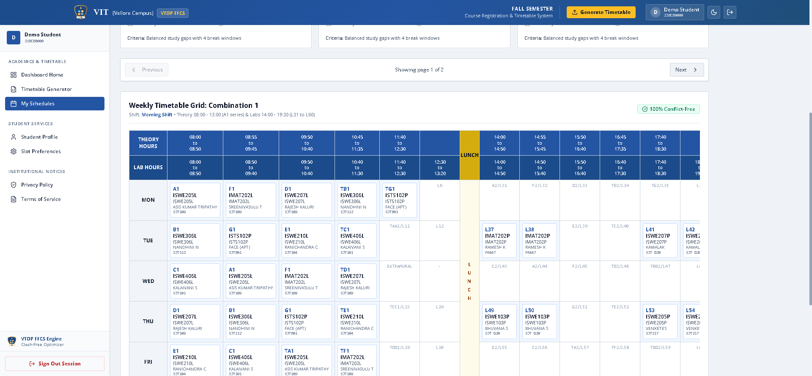
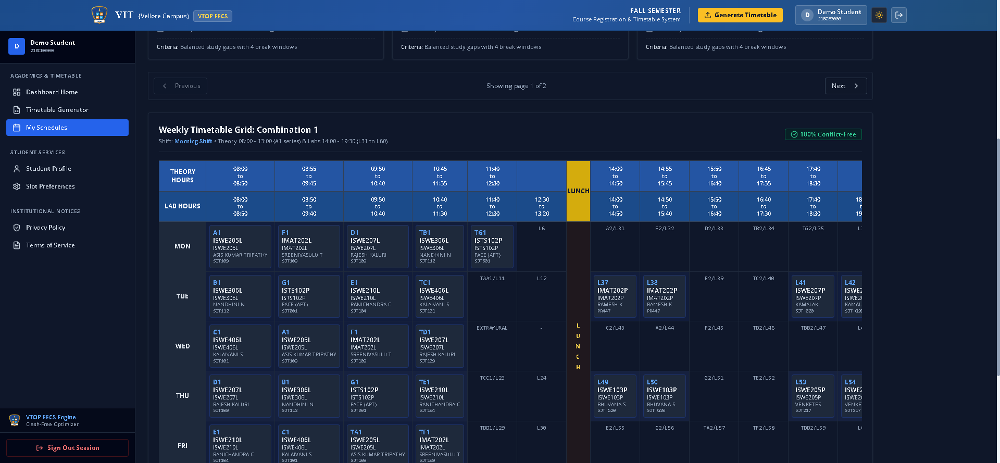

# 🎓 VIT FFCS Agent - Full-Stack Academic Timetable Optimizer

[](LICENSE)
[](https://nodejs.org/)
[](https://react.dev/)
[](https://www.typescriptlang.org/)
[](https://tailwindcss.com/)
[](https://www.mongodb.com/)
[](https://expressjs.com/)

An intelligent full-stack automation platform designed for VIT (Vellore Institute of Technology) students to generate clash-free, credit-compliant, and optimized academic timetables from their VTOP course registration Excel exports.

---

## 📸 Screenshots

| Light Mode Timetable Grid | Dark Mode Timetable Grid |
| :---: | :---: |
|  |  |

---

## ✨ Features

- **⚡ Instant VTOP Excel Parsing**: Automatically ingests and validates Course Registration `.xlsx` files, mapping courses, faculties, credits, and slot codes into memory.
- **🔄 Clash-Free Backtracking Engine**: Computes valid timetable combinations without slot collisions using VIT's complex slot mapping matrix.
- **🎯 18–27 Credit Constraint Enforcement**: Enforces VIT academic limits (minimum 18 credits, maximum 27 credits) across all generated timetable permutations.
- **🌅 Batch Filtering**: Select your ideal routine:
  - **Morning Batch** (`*1` theory slots + `L1–L30` lab slots)
  - **Evening Batch** (`*2` theory slots + `L31–L60` lab slots)
  - **Both Batches** (mixed schedule combinations)
- **🧠 Multi-Criteria Ranking Algorithm**:
  - **Balanced**: Uniformly distributes classes throughout the week.
  - **Earliest Finish**: Prioritizes finishing classes early in the day.
  - **No Morning Classes**: Minimizes or eliminates early 8:00 AM slots.
  - **Max Free Days**: Clusters lectures and labs to maximize full days off.
- **🌓 Modern Responsive UI**: Built with React 18, TypeScript, Tailwind CSS, Lucide icons, glassmorphism UI cards, and system-aware dark/light theme switching.
- **🔐 Hardened Security Architecture**:
  - HTTP-only lax session cookies with JWT authentication.
  - Salted bcrypt password hashing (`bcryptjs`).
  - NoSQL injection sanitization (`mongoSanitize`).
  - Dynamic rate limiting on auth, upload, and generation endpoints.
  - Helmet CSP and security transport headers (`HSTS`, `X-Content-Type-Options`).
  - Constant-time secret signature verification for webhooks.
- **🤖 n8n & WhatsApp Bot Ready**: Exposes authenticated webhook endpoints for headless timetable generation and WhatsApp delivery.

---

## 🏗️ Architecture

```
┌──────────────────────────────────────────────────────────────┐
│                    User Interfaces                           │
│  ┌─────────────────────────────┐   ┌──────────────────────┐  │
│  │ React 18 + Vite Web Client  │   │ WhatsApp / n8n Bot   │  │
│  └──────────────┬──────────────┘   └──────────┬───────────┘  │
└─────────────────┼─────────────────────────────┼──────────────┘
                  │ HTTPS (REST + Cookie / JWT)  │ Webhook Token
                  ▼                             ▼
┌──────────────────────────────────────────────────────────────┐
│                  Express.js Security Layer                   │
│  • Helmet CSP & Headers        • Rate Limiting Throttle      │
│  • CORS Filtering              • NoSQL Injection Sanitizer   │
└──────────────────────────────┬───────────────────────────────┘
                               │
                               ▼
┌──────────────────────────────────────────────────────────────┐
│                     Core Backend Services                    │
│  ┌───────────────────────────┐   ┌────────────────────────┐  │
│  │   Excel Ingestion Parser  │   │ Timetable Generation   │  │
│  │   (xlsx stream parsing)   │   │ (Backtracking Engine)  │  │
│  └──────────────┬────────────┘   └───────────┬────────────┘  │
│                 │                            │               │
│                 ▼                            ▼               │
│          VIT Slot Matrix             Credit Validator        │
│          (Theory & Labs)             (18–27 Range Limit)     │
└──────────────────────────────┬───────────────────────────────┘
                               │
                               ▼
┌──────────────────────────────────────────────────────────────┐
│                      MongoDB Storage                         │
│  • Users & Preferences       • Generated Timetable Cache     │
│  • Semester Configurations   • Audit Activity Logs           │
└──────────────────────────────────────────────────────────────┘
```

---

## 📁 Repository Structure

```
ffcs/
├── backend/
│   ├── models/                 # Mongoose schemas (User, Course, SemesterConfig, Timetable)
│   ├── routes/
│   │   ├── auth.js             # Authentication, session cookies, profiles & preferences
│   │   ├── timetable.js        # File upload, parsing, generation & retrieval
│   │   └── webhook.js          # Authenticated n8n / WhatsApp agent endpoints
│   ├── services/
│   │   ├── excelParser.js      # Robust VTOP course registration Excel parser
│   │   └── timetableGenerator.js # Backtracking timetable permutation engine
│   ├── utils/
│   │   ├── auth.js             # Bcrypt hashing & JWT session helpers
│   │   ├── middleware.js       # Authentication & constant-time webhook verification
│   │   ├── sanitize.js         # Input sanitization & NoSQL injection guards
│   │   └── slotMapping.js      # VIT slot definitions, clashes & day timings
│   ├── tests/                  # Jest unit and integration test suite
│   ├── server.js               # Express application entrypoint
│   ├── package.json
│   └── .env.example            # Backend environment configuration template
│
├── frontend/
│   ├── src/
│   │   ├── components/         # Modular layout, dashboard, navigation & UI primitives
│   │   ├── context/            # AuthContext and ThemeContext providers
│   │   ├── pages/              # Portal pages (Upload, Results, Account, Terms, Privacy)
│   │   ├── lib/                # API client wrapper & analytics utilities
│   │   ├── App.tsx             # Route definitions & protected route guards
│   │   └── index.css           # Tailwind CSS design system tokens
│   ├── public/                 # Static assets, logos, and web manifests
│   ├── package.json
│   ├── vite.config.ts          # Vite build configuration
│   └── .env.example            # Frontend environment template
│
├── .gitignore                  # Production-grade gitignore rules for public repos
└── README.md
```

---

## 🚀 Getting Started

### Prerequisites

- [Node.js](https://nodejs.org/) (v18 or higher recommended)
- [MongoDB](https://www.mongodb.com/) (Local instance running on `mongodb://127.0.0.1:27017` or MongoDB Atlas URI)
- `npm` or `yarn`

### 1. Clone the Repository

```bash
git clone https://github.com/shreev1120/ffcs.git
cd ffcs
```

### 2. Configure Backend Environment

Copy the environment template in `backend/`:

```bash
cp backend/.env.example backend/.env
```

Review and configure your values in `backend/.env`:

```env
PORT=5000
NODE_ENV=development
FRONTEND_URL=http://localhost:5173
MONGODB_URI=mongodb://127.0.0.1:27017/ffcs-agent
JWT_SECRET=your_secure_development_jwt_secret_key_at_least_32_characters
WEBHOOK_SECRET=your_secure_webhook_secret_for_n8n
UPLOAD_DIR=./uploads
```

### 3. Configure Frontend Environment (Optional)

```bash
cp frontend/.env.example frontend/.env
```

Default value in `frontend/.env`:
```env
VITE_API_BASE_URL=/api
```

### 4. Install Dependencies

```bash
# Install backend dependencies
npm install --prefix backend

# Install frontend dependencies
npm install --prefix frontend
```

### 5. Start the Application

In **Terminal 1** (Backend):
```bash
cd backend
npm run dev
```
> Server runs on `http://localhost:5000`

In **Terminal 2** (Frontend):
```bash
cd frontend
npm run dev
```
> Web client runs on `http://localhost:5173`

---

## 📡 API Reference

### Authentication Endpoints

| Method | Endpoint | Description | Auth Required |
| :--- | :--- | :--- | :--- |
| `POST` | `/api/auth/signup` | Register student with `@vitstudent.ac.in` email | No |
| `POST` | `/api/auth/login` | Authenticate student and issue HTTP-only cookie | No |
| `POST` | `/api/auth/logout` | Terminate session and invalidate cookie | Yes |
| `GET` | `/api/auth/me` | Retrieve profile for authenticated user | Yes |
| `PUT` | `/api/auth/profile` | Update profile information | Yes |
| `PUT` | `/api/auth/preferences`| Update default batch, ranking criteria, max results | Yes |
| `PUT` | `/api/auth/password` | Update student account password | Yes |
| `GET` | `/api/auth/dashboard/stats` | Retrieve user schedules count & metrics | Yes |
| `GET` | `/api/auth/dashboard/activity` | Retrieve recent activity audit trail | Yes |

### Timetable Engine Endpoints

| Method | Endpoint | Description |
| :--- | :--- | :--- |
| `POST` | `/api/timetable/upload-excel` | Upload and parse student VTOP course registration Excel file |
| `POST` | `/api/timetable/generate` | Execute clash-free backtracking generation with credit limits |
| `GET` | `/api/timetable/config/:configId` | Fetch parsed semester course catalog and configuration |
| `GET` | `/api/timetable/user/:userId` | Retrieve saved timetables for a student |

### Automation & Webhook Endpoints

| Method | Endpoint | Description |
| :--- | :--- | :--- |
| `GET` | `/api/webhook/health` | Webhook service health check |
| `POST` | `/api/webhook/user-state` | Update conversation state machine (n8n/WhatsApp) |
| `GET` | `/api/webhook/user/:whatsapp`| Fetch non-sensitive user state by WhatsApp number |

---

## 🧪 Testing

Both frontend and backend are covered by automated test suites:

```bash
# Run backend tests (Jest)
npm test --prefix backend

# Run frontend tests (Vitest)
npm test --prefix frontend

# Validate production frontend build
npm run build --prefix frontend
```

---

## 🛡️ Security & Privacy Practices

- **Zero Hardcoded Secrets**: Secrets and database URIs are loaded exclusively from runtime environment variables.
- **Strict Public Exclusion**: Sensitive file extensions (`.env*`, `*.pem`, `*.key`, `*.pfx`, `*.xlsx`, `*.pdf`, `*.sqlite`, `.venv/`) are blocked by `.gitignore`.
- **Least-Privilege Logging**: Personal passwords, hashes, and authorization headers are never logged to console or log files.
- **Brute Force Protection**: IP-based rate limiting on authentication attempts and timetable generation routines.

---

## 🤝 Contributing

Contributions, issues, and feature requests are welcome!
Feel free to open an issue or submit a Pull Request:

1. Fork the Project
2. Create your Feature Branch (`git checkout -b feature/AmazingFeature`)
3. Commit your Changes (`git commit -m 'feat: add amazing feature'`)
4. Push to the Branch (`git push origin feature/AmazingFeature`)
5. Open a Pull Request

---

## 📄 License

Distributed under the **MIT License**. See [`LICENSE`](LICENSE) for more details.

---

<p align="center">
  <strong>Made with ❤️ for VIT Students</strong>
</p>
